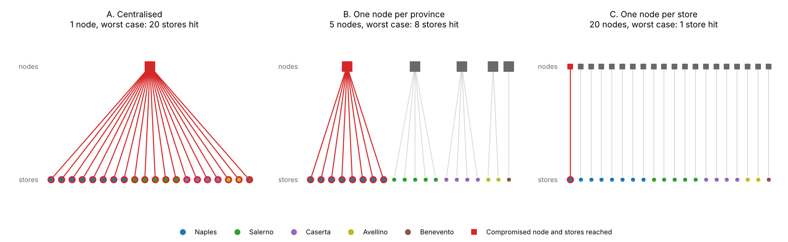
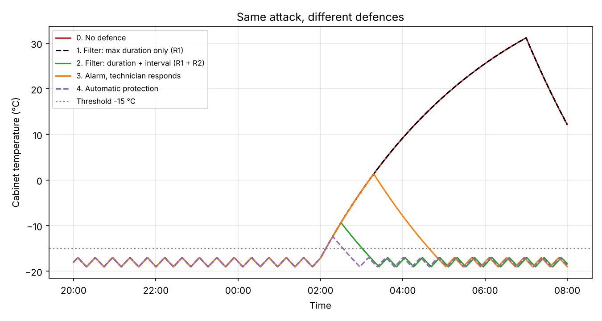

# One compromised node, how many stores?

**Blast radius and in-store defences in supermarket refrigeration remote management — a simulation study.**

Fabio Greco · Paper (preprint): [`paper/en/main.pdf`](paper/en/main.pdf)

In October and November 2026 the refrigeration controllers of supermarkets in several European countries, including about 700 sites in France and stores in Italy, were remotely manipulated to force long high-temperature defrost cycles at night. This repository asks two questions about that kind of attack:

1. **How many stores can a single compromised remote-management node reach**, depending on how remote management is organised?
2. **Which defences placed inside each store limit the damage** even when that node is in the attacker's hands?

The starting point is the software-engineering idea of a *single point of failure*, read here as a single point of **compromise**: the node keeps working but sends harmful commands (integrity, not availability).

Everything runs in simulation: a lumped first-order thermal model of a freezer cabinet, written in state-space (input-state-output) form, a hypothetical chain of 20 stores in Campania (Italy), three remote-management architectures and a scripted attacker that anticipates a defrost duration limit.

> **Scope.** The parameters are illustrative and the store chain is hypothetical. The results show a mechanism; they are not measurements of real installations. No real system was scanned, contacted or tested.

## Key results



**Blast radius.** With one compromised node and no in-store defences:

| Architecture | Nodes | Stores hit (worst case) | Loss (worst case) |
| --- | ---: | ---: | ---: |
| A. Centralised | 1 | 20 | €600,000 |
| B. One node per province | 5 | 8 | €240,000 |
| C. One node per store | 20 | 1 | €30,000 |

**In-store defences.** Same attack from 02:00; staff arrive at 07:00 and switch the cabinet to local mode. A store *exceeds the loss criterion* if its cabinet stays above −15 °C for more than 60 cumulative minutes (a convention of this study, not a regulatory limit).

| Scenario | Defrost executed | Peak temperature | Minutes above −15 °C | Loss criterion |
| --- | ---: | ---: | ---: | --- |
| 0. No defence | 300 min | 31.2 °C | ≥ 352 | exceeded |
| 1. Filter, max duration only (R1) | 300 min | 31.2 °C | ≥ 352 | exceeded |
| 2. Filter, max duration + min interval (R1 + R2) | 30 min | −9.3 °C | 53 | **met** |
| 3. Independent alarm, technician responds | 78 min | 1.4 °C | 151 | exceeded |
| 4. Independent alarm, automatic protection | 18 min | −12.3 °C | 25 | **met** |

In scenarios 0 and 1 the cabinet is still above the threshold when the simulation ends at 08:00, so their minutes are a lower bound.



**What it shows.**

- Architecture decides how many stores fail together.
- A single rule is not enough: a duration limit alone is bypassed by repeating short commands. A stateful rule, a minimum interval between defrosts, stops it, provided the interval is long enough to prevent another remote defrost from starting before staff take over at 07:00 (with commands every 30 minutes, more than 4.5 hours here; with 4.5 hours or less a second defrost starts before 07:00 and the criterion is exceeded).
- An alarm that calls a technician lowers the peak but does not keep the cabinet within the criterion. It does only if the response comes within about 15 minutes, which is difficult to guarantee at night without an automatic response.
- Reducing the blast radius and enforcing limits inside each store are complementary: the first bounds how many stores an attacker reaches, the second what happens in each of them.
- The conclusions hold when the cabinet's heat capacity is halved or doubled and when the attack start time moves along one thermostat cycle. They do **not** hold for every cabinet: with a 25% higher thermal conductance or a 50% higher defrost power, a 30-minute duration limit is no longer enough, while the automatic protection stays within the criterion in every case (`passo4_sensibilita.py`).
- Closed-form solutions of the state-space model reproduce the simulation within 0.2 minutes and give two design limits for the base cabinet: a maximum admissible defrost duration of 33.1 minutes and a maximum alarm response time of 15.2 minutes. Across the cabinets studied they range from 24.6 to 53.4 and from 5.4 to 24.4 minutes, so the limits must be computed for each cabinet (`passo5_forma_chiusa.py`).
- An in-store protection costing *c* euros per store per year pays for itself when the yearly probability of a successful attack exceeds *c* / Δ*L*, where Δ*L* is the loss it avoids (here the whole €30,000): for example 0.33% for €100 and 1% for €300 (example costs, not market prices; a preliminary break-even assessment, not a full cost-benefit analysis).

## Quick start

Requires Python 3.9+ and matplotlib.

```bash
git clone https://github.com/lightskinF/refrigeration-blast-radius.git
cd refrigeration-blast-radius
python -m venv .venv
source .venv/bin/activate        # Windows: .venv\Scripts\activate
pip install -r requirements.txt
python run_all.py
```

`run_all.py` runs the scripts in order, writes the figures to `figures/` (English versions in `figures/en/`) and the printed numbers to `results/`. The committed `results/` files hold the numbers reported in the paper, so `git diff results/` after a run shows whether anything changed. Each script can also be run on its own, for example `python src/passo3_difese.py`.

## Repository structure

```text
refrigeration-blast-radius/
├── README.md
├── LICENSE                      MIT (code)
├── CITATION.cff
├── requirements.txt
├── run_all.py                   runs everything, saves figures and outputs
├── src/
│   ├── passo1_banco_frigo.py    step 1: thermal model of one cabinet
│   ├── passo2_negozi.py         step 2: chain of 20 stores, three architectures
│   ├── passo3_difese.py         step 3: attacker, filter, alarm, automatic protection
│   ├── passo4_sensibilita.py    step 4: one-at-a-time sensitivity analysis
│   ├── passo5_forma_chiusa.py   step 5: state-space model, closed form, limits per cabinet, break-even
│   ├── figura_architetture.py   architecture diagram
│   └── figures_en.py            English versions of the figures
├── figures/                     generated figures (Italian labels)
│   └── en/                      same figures with English labels (README, paper)
├── results/                     generated text outputs, one per script
└── paper/
    ├── README.md                how to build the paper
    ├── make_arxiv.py            builds the arXiv source bundle
    └── en/                      English paper (main.tex, references.bib, main.pdf)
```

Each script imports from the previous one, so they read in order. Code, comments and printed output are in Italian, because the project was built step by step as a learning exercise. A short glossary: *banco frigo* = freezer cabinet, *negozi* = stores, *difese* = defences, *sbrinamento* = defrost, *soglia* = threshold, *merce persa* = loss criterion exceeded, *entro / oltre il criterio* = criterion met / exceeded, *sensibilità* = sensitivity.

## The model in brief

The cabinet is represented by a single temperature $T$, the mean temperature of the cabinet and its contents (structure, air and products lumped together):

$$C \frac{dT}{dt} = UA\,(T_{amb} - T) - P_f\,u_c + P_s\,u_s$$

where $u_c$ and $u_s$ switch the compressor and the defrost heaters on or off. A hysteresis thermostat keeps $T$ between −19 and −17 °C. A defrost turns the compressor off and the heaters on. The equation is integrated with explicit Euler and a 10 s step, and verified against the exact exponential solution: both give 31.2 °C after 300 minutes of defrost. This verifies the code; it does not validate the model against real cabinets.

| Parameter | Value |
| --- | --- |
| Store temperature $T_{amb}$ | 22 °C |
| Setpoint ± hysteresis | −18 ± 1 °C |
| Threshold | −15 °C (−18 °C + 3 °C tolerance in retail display cabinets, Directive 89/108/EEC, Art. 5; Italian Legislative Decree 110/1992, Art. 4) |
| Thermal conductance $UA$ | 20 W/°C |
| Heat capacity $C$ | 300,000 J/°C, e.g. 120 kg of frozen products × 2 kJ/(kg K) = 240 kJ/°C plus about 60 kJ/°C of structure (time constant 250 min) |
| Cooling power $P_f$ | 1,600 W |
| Defrost power $P_s$ | 600 W effective thermal power, not necessarily the heaters' nominal rating (equilibrium under continuous defrost: 52 °C, an asymptotic value) |
| Loss criterion | more than 60 cumulative minutes above the threshold |
| Goods value per store | €30,000 (the loss scales linearly with it) |

In state-space form the state is $x = T$, the inputs are $u = [u_c, u_s]$, $w = T_{amb}$ is a disturbance and the output is $y = x$, i.e. $\dot{x} = Ax + Bu + Ew$ with $A = -1/\tau$, $B = [-P_f/C,\ P_s/C]$, $E = 1/\tau$; the system is linear, time-invariant and stable (eigenvalue $-1/\tau$), and with constant inputs $x(t) = x_{eq} + (x_0 - x_{eq})e^{-t/\tau}$. This gives the time to cross the threshold, the minutes above it for a defrost of any duration, and the limits above, without simulating.

The model neglects the latent heat of melting. The decisive scenarios stay at or below −9.3 °C; the scenarios that go above 0 °C exceed the loss criterion before reaching 0 °C.

**Attacker.** Controls one node and runs a script without feedback: at 02:00 a 600-minute defrost and, also starting at 02:00 and then every 30 minutes until 07:30, the longest defrost a filter would allow (30 minutes): 13 commands. Overlapping commands have no extra effect, so the results report the minutes of defrost actually executed. The switch to local mode at 07:00 interrupts any remote defrost in progress, returns control to the thermostat and takes precedence over a command arriving at the same instant.

**Defences, all inside the store.** A command filter with R1 (maximum defrost duration, 30 min) and R2 (at least 6 h between the start times of accepted defrosts). An independent alarm that fires after 10 consecutive minutes above the threshold, with either a technician on site 60 minutes later or an automatic protection that stops the defrost itself. In practice they assume a device separate from the supervised controller, settings changeable only on site, and an own temperature sensor with a local event log. The automatic protection is the simplest case of a non-networked **temperature band limiter**: its upper bound near −15 °C protects the goods, and on a fault it removes power from the defrost heaters while the compressor stays under the cabinet's local control. Protecting the equipment from overheating is a separate function, with its own sensors and manufacturer-set limits. The independent sensor measures a local temperature used as a proxy for the lumped $T$; the simulation assumes the two coincide.

## Script → paper

| Script | Paper |
| --- | --- |
| `figura_architetture.py` | Figure 1 |
| `passo1_banco_frigo.py` | Figure 2 |
| `passo2_negozi.py` | Table 4, Figure 3 |
| `passo3_difese.py` | Table 5, Figure 4 |
| `passo4_sensibilita.py` | Table 6, Figure 5 |
| `passo5_forma_chiusa.py` | Tables 7 and 8, break-even condition |

## Limitations

- **Hypothetical chain.** It is not known how centralised remote management actually is in Campania. The blast-radius result applies to operators whose nodes reach several stores.
- **Illustrative, lumped model.** Not calibrated on a real cabinet; the air warms faster and the core of the products more slowly than the lumped temperature. Latent heat is neglected.
- **Loss criterion.** The −15 °C threshold refers to product temperature in the directive; the 60-minute tolerance is a convention of this study.
- **Narrow threat model.** One compromised node, one command type (defrost); real cases also included setpoint changes. The in-store defences are assumed not to be remotely reconfigurable. If every store shares the same exposed weakness, segmentation alone does not help.
- **Measured vs modelled temperature.** The independent sensor measures a local temperature, the model a lumped one; their relation must be calibrated on a real cabinet.
- **Cabinet parameters.** The filter result depends on $UA$ and $P_s$, whose values are illustrative.
- **Cost analysis.** Protection costs are examples; unnecessary trips, interruptions of refrigeration and failures of the protection are neglected.
- **Conceptual protection.** The band limiter is a conceptual architecture evaluated only in the model; it has not been built or tested.
- **Normal operation.** The filter rules must be compatible with the cabinet's normal defrost schedule.

## Responsible research

- Simulation only: no real device or network was scanned, contacted or tested.
- No stores or vendors in Campania are named, and no intrusion technique is described.

## Citation

See `CITATION.cff`, or use the "Cite this repository" button on GitHub:

> F. Greco, *One Compromised Node, How Many Stores? Blast Radius and In-Store Defences in Supermarket Refrigeration Remote Management*, preprint, 2026.

## Declaration on generative AI

Large language models (LLMs) were used for a more rigorous formatting of the mathematical formulas, for generating the figures in the paper and as assistance in writing the Python simulation code. The author re-ran and checked the generated code and its results, and takes full responsibility for the publication.

## License

Code: [MIT](LICENSE). Paper text and figures: [CC BY 4.0](https://creativecommons.org/licenses/by/4.0/).

---

### In italiano

Studio in simulazione di quanti supermercati può colpire un singolo nodo di telegestione della refrigerazione compromesso, e di tre difese installate nel negozio: un filtro dei comandi di sbrinamento, un allarme indipendente con intervento di un tecnico e una protezione automatica. Il lavoro prende spunto dagli attacchi di ottobre e novembre 2026 ai banchi frigo dei supermercati europei e usa una catena ipotetica di 20 negozi in Campania. Per eseguire tutto: `pip install -r requirements.txt` e poi `python run_all.py`. Il codice e i commenti sono in italiano; il paper in inglese è in `paper/en/`.
